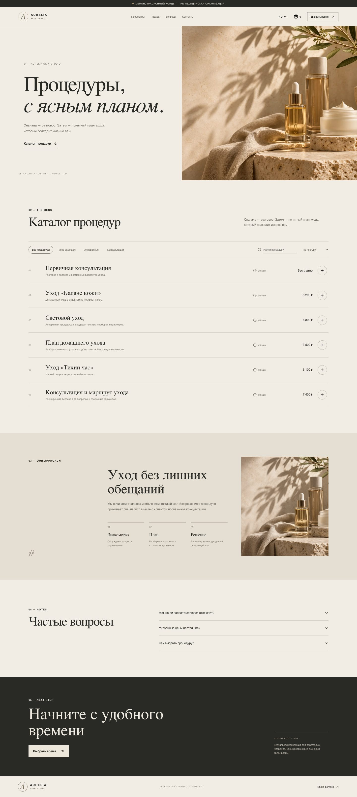
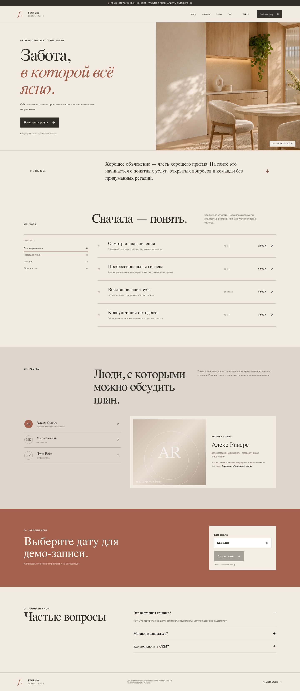
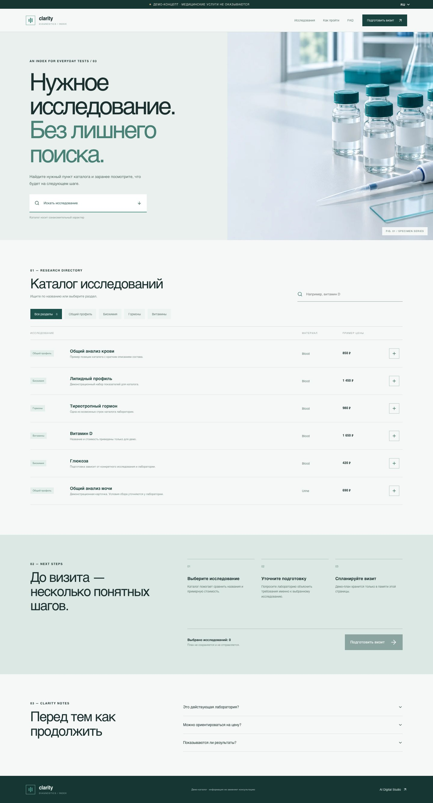
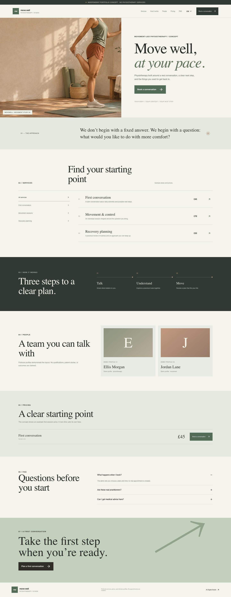
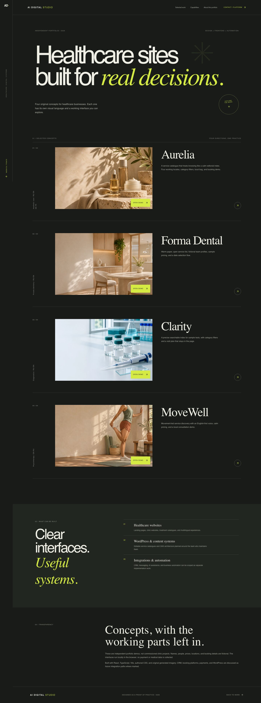

# Project case studies

These are self-initiated concept projects created for this portfolio. They are demonstrations of design and frontend implementation, not paid client work or proof of business outcomes.

## Aurelia Aesthetic Clinic

**Live demo:** [Aurelia](https://healthcare-web-studio-portfolio-20261108.cocoapause1.chatgpt.site/sites/aurelia/index.html)  
**Brief:** show how a small aesthetic clinic could present a service catalog in four languages, then let a visitor compare treatments and try a sample order/booking path.

**The design choice.** A warm, quiet gallery gives the service catalog room to work. Treatments are listed in scannable rows; category controls, search, and sorting support discovery without adding a multi-step filter panel.

**Implemented.** RU/EN/DE/FR content; catalog category filters; search and price sorting; treatment detail dialog; cart with quantity changes, removal, and total calculation; local-only checkout confirmation; date/time booking demonstration; FAQ; responsive menu.

**Not connected.** There is no payment, order persistence, email, CRM, appointment calendar, or server submission. The displayed prices, name, business, and appointments are sample content.

## Forma Dental

**Live demo:** [Forma](https://healthcare-web-studio-portfolio-20261108.cocoapause1.chatgpt.site/sites/forma/index.html)  
**Brief:** give a fictional dental practice a distinct editorial identity and show service discovery, sample team information, and a simple appointment journey.

**The design choice.** Paper, dark ink, and muted terracotta make the page feel tactile without using a familiar grid of interchangeable treatment cards. The service list and team profiles use a more editorial rhythm than Aurelia.

**Implemented.** RU/EN language toggle; service filtering; fictional sample profiles with no claimed credentials; example prices; date/time selection; local demo confirmation; expandable FAQ; responsive navigation.

**Not connected.** No real practitioners, clinic location, reviews, live calendar, patient data submission, or backend.

## Clarity Diagnostics

**Live demo:** [Clarity](https://healthcare-web-studio-portfolio-20261108.cocoapause1.chatgpt.site/sites/clarity/index.html)  
**Brief:** make a sample diagnostic catalog easy to scan while drawing a clear boundary between an informational catalog and actual test results.

**The design choice.** A precise index replaces promotional tiles: search, category controls, and aligned rows make example tests the main content. A detail view and visit-plan area explain the interaction without simulating clinical results.

**Implemented.** RU/EN toggle; search; category filtering; test detail dialog; selected-test plan; local appointment flow; empty-state reset; FAQ; responsive layout.

**Not connected.** No lab order, patient portal, specimen instructions validated by a laboratory, health record, results, diagnosis, or personal data capture.

## MoveWell Physiotherapy

**Live demo:** [MoveWell](https://healthcare-web-studio-portfolio-20261108.cocoapause1.chatgpt.site/sites/movewell/index.html)  
**Brief:** show the service structure and first-visit steps for a fictional physiotherapy studio.

**The design choice.** A daylight-led art direction and wider image fields carry the page. Services and consultation steps are laid out as a movement through the page rather than another clinic catalog.

**Implemented.** EN/RU toggle; service filters; process steps; fictional sample practitioners; example pricing; FAQ; date/time consultation demonstration; responsive navigation.

**Not connected.** No clinician credentials, real location, diagnosis, rehabilitation prescription, appointment system, or data transmission.

## Portfolio

**Live demo:** [AI Digital Studio portfolio](https://healthcare-web-studio-portfolio-20261108.cocoapause1.chatgpt.site/)  
**Brief:** make the differences between the four concepts visible and take a prospective client directly to a relevant demo.

**Implemented.** Live project links, portfolio screenshots, a concise capability summary, responsive navigation, and a visual system separate from the clinic concepts.

**Claim boundary.** There are no client logos, testimonials, “before/after” results, or performance statistics. Describe each work sample as a portfolio concept.

## Reusable delivery pattern

1. Clarify the audience, decision, and next action before selecting a visual direction.
2. Separate real supplied facts from sample content.
3. Use original licensed assets and document their source.
4. Keep the prototype interaction honest: state what works locally and what needs a real integration.
5. Test the main visitor journeys at phone, tablet, and desktop sizes before handoff.
